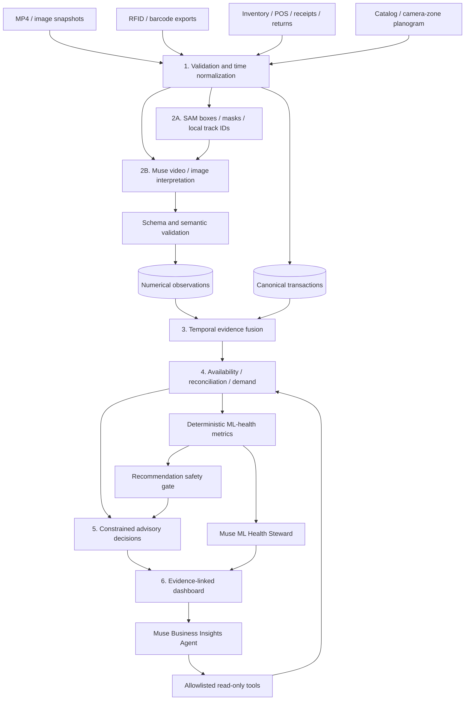

# Architecture

## Six-stage pipeline

## Roles of models versus code

Muse extracts structured observations and chooses evidence-query tools. It does
not become an inventory ledger or perform authoritative arithmetic. SAM generates
geometry/track identities, not UPC recognition or payment verification. Python
validates every observation, computes exposures, reconciles quantities, trains
models, calculates diagnostics and builds constrained recommendations.

The same Muse model powers three different bounded roles:

| Role | Input | Permitted result |
|---|---|---|
| Perception | Registered clip/image, catalog, optional SAM geometry | Locally validated visual observation batch |
| ML Health Steward | Computed health, evaluation and source metrics | Explanation, caveats and proposed checks |
| Business Insights | A business question plus approved read-only tools | Grounded interpretation and recommended human action |

## Stage 1: canonical source ingestion

A transaction represents one recorded stock mutation with a stable namespaced
source ID. Replaying that ID is idempotent. Conflicting contents under an existing
ID are quarantined; the original remains unchanged. Products and evidence must
exist before observations reference them. CSV readers preserve identifier strings.

Timestamps carry offsets. Optional source timezone conversion rejects ambiguous or
nonexistent DST times. A clock correction is subtracted from a fast source clock.
A real deployment should estimate offsets from shared events; this prototype takes
explicit operator-provided offsets instead of silently guessing alignment.

## Stage 2: visual extraction

Perception uses registered evidence IDs. Muse returns SKU/zone, clip-relative start
and end, event class, availability, visible-count bounds, visibility, confidence and
notes. Output is schema-constrained at the API and revalidated locally. Events
outside the clip or catalog are rejected. A rejected batch does not partially
insert observations. Raw provider output is retained for review.

Native video is supported. Clips are intentionally bounded to 90 seconds and
25 MB by default. Large surveillance archives should be indexed and split by an
upstream exporter. This release does not claim it searches an entire NVR archive.

SAM output preserves source frame index and object ID, including sparse frame
indices. IDs are not a promise of identity across camera changes, complete
occlusion or separate requests. Encoded masks are retained; box overlays do not
pretend to be decoded pixel segmentation.

## Stage 3: temporal state

**Availability** is an interval union over each SKU's open-store hours. Known
available, known unavailable and unknown hours sum to observed open hours.
Overlapping views never multiply exposure. Conflicting high-quality observations
become unknown. Low visibility is not proof of an empty shelf. There is no
unbounded last-observation-carried-forward inference across camera gaps.

**Whole-store inventory** has a separate discrete count posterior. Recorded stock
movements shift it. Positive visual counts can constrain a lower bound. Unique
RFID EPCs in a scan provide another lower bound by default. A binomial read model
is optional and requires an externally justified detection probability.
Certified whole-store audits anchor the posterior. Only recent verified counts
support negative/positive variance classifications in this release.

A removal on video does not decrement total inventory: the product may be in a
basket, on another shelf or in a backroom. Its POS sale, if recorded, supplies the
one canonical decrement. Internal relocation is not store-level shrink. Unverified
physical discrepancies remain unresolved rather than becoming theft findings.

## Stage 4: demand and model health

The model learns from eligible recorded sales during known available exposure.
Unavailable intervals are not labeled as zero demand. Unknown intervals are not
labeled as stockouts. The baseline pools product/weekday exposure rates; the ML
candidate uses a regularized Poisson rate model with product, weekday and trend.

Train/validation/test splits are strictly chronological. The candidate is chosen
on validation only, refit on train+validation for the held-out test, then the
selected architecture is refit on measured history for subsequent deployment.
Holdout sales metrics use fully available days. Synthetic latent-demand evaluation
is separate and reads withheld simulator labels only after predictions exist.

Health checks detect unreliable inputs as well as forecasting issues. Their
PASS/WARN/FAIL categories are computed in Python and cannot be overridden by Muse.
The agent recommends checks, not autonomous retraining or deployment. Foreground
monitoring can request interpretations on changed health categories. A stale or
failed health gate also blocks previously generated order recommendations when
served to the dashboard/agent.

## Stage 5: advisory decisions

The policy enumerates 1-, 2-, 3- and 7-day review intervals, applies a conditional
Poisson service target and enforces shelf capacity and case packs. It considers
lead time. Unknown physical positions, insufficient measured exposure, low camera
coverage, health failure, misplacement or damage can block a proposed order until
review. It does not assume damaged/relocated merchandise is usable shelf stock.

This policy is not claimed as a global optimizer. There are no automated order,
ledger, route or planogram write paths.

## Stage 6: agents and interface

Each business-agent request has fixed store scope and bounded rounds/tools. The
allowlist exposes summaries, a product record, events, health, evaluation metrics
and existing recommendations. No arbitrary SQL or shell execution is possible.
Retrieved metric/evidence IDs are validated in final structured responses. Tool
traces are visible. The browser has no provider API key; only the Python backend
can call Meta.

## Persistence

SQLite WAL keeps installation small and supports a local API plus foreground
monitor. Short transactions, parameterized SQL, bounded pipeline leases and
atomic report replacements avoid common prototype integrity problems. Numeric
source fields are validated before storage; JSON payloads preserve schema detail.
Large-scale deployments should use managed storage/queues and a proper access
layer. Do not mistake a single-machine research service for a production platform.
